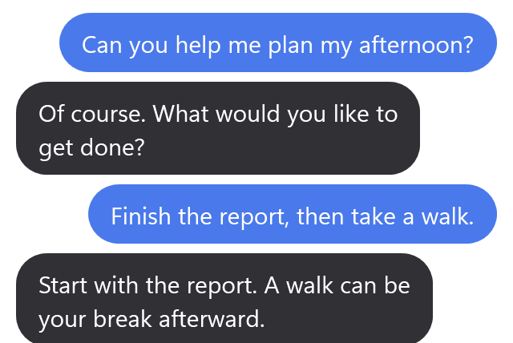
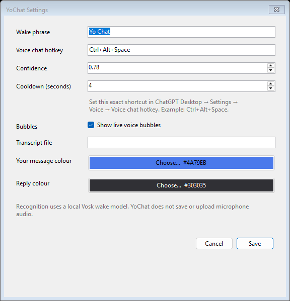

# YoChat — ChatGPT voice overlay for Windows

**macOS and Linux:** separate [experimental versions](experimental/README.md)
are available as source installs. Native live-call testing is pending; Linux
initially requires X11. The working Windows version below is unchanged.

**Say “Yo Chat.” Talk to ChatGPT. Read the conversation without leaving your app.**

YoChat is an open-source Windows tray app that adds a configurable **wake word**
and **floating live transcript bubbles** to compatible ChatGPT desktop voice
sessions. Your messages and ChatGPT’s replies appear above the native voice
pill, follow it as you move it, and disappear when you close voice.

Keep your editor, browser, or document in front. No separate transcript window
needs to stay on your screen.

[Getting started](#getting-started) · [Compatibility](#compatibility) ·
[Settings](#settings) · [Troubleshooting](#troubleshooting) · [MIT license](LICENSE)

<p align="center">
  
</p>
<p align="center"><em>Actual YoChat bubble renderer with sample messages. This is a layout preview, not a recording of a live call; the native ChatGPT pill is not shown.</em></p>

> **Compatibility matters:** live bubbles currently depend on an internal local
> voice-transcript file exposed by the desktop build used during development.
> They do **not** work with every ChatGPT installation. Check
> [compatibility](#compatibility) before installing.

## What you get

- **Hands-free voice activation.** “Yo Chat” is the default wake phrase; choose
  your own phrase, recognition confidence, and cooldown.
- **Both sides of the conversation.** Read your speech and ChatGPT’s responses
  in a compact, always-on-top chat overlay. Updates arrive at completed speech
  segments, rather than guaranteed word-by-word captions.
- **Bubbles that stay with the pill.** Move the native voice control and the text
  follows. It leaves room for prompt cards when their bounds are available.
- **A small desktop footprint.** Up to five complete messages, with a full-message
  reader for oversized replies. Closing voice hides the bubbles.
- **Local wake recognition.** Windows Speech handles the wake phrase. YoChat
  needs no API key and runs no separate transcription service.
- **One tray app.** Pause listening, change settings, check the transcript
  connection, or exit from the tray menu. Starting on login is optional.

Useful when you want a ChatGPT voice assistant beside your work, a readable
voice-chat overlay, or a wake-word launcher without keeping the full chat open.

## Compatibility

| Requirement | Current support |
| --- | --- |
| Operating system | Windows; packaged for x64. ARM64 is untested. |
| ChatGPT | A signed-in desktop build with the native floating voice pill and the transcript source below |
| ChatGPT UI language | English control names are used to locate the pill |
| Microphone | Windows desktop-app microphone access and an installed Windows Speech recognizer |
| Browser version | Not supported |
| API key | Not required |

The tested desktop build exposes local Work/voice conversations and updates:

```text
%USERPROFILE%\.codex\realtime-voice-continuity.json
```

**This file is an internal format, not a stable public API.** A normal ChatGPT
installation may not produce it. During an active voice call, the file must
exist and update for live bubbles to work. YoChat reports a missing source in
its tray status; it does not open a full chat window to work around it.

Adjacent entries with exactly the same speaker and text are shown once, because
the source can publish duplicate segments. Without message IDs, identical
back-to-back utterances from one speaker are indistinguishable; repeats across
another speaker's turn and different wording are preserved.

YoChat respects `CODEX_HOME` if set. You can also choose a transcript file in
Settings. The supported format has `version: 1` and per-thread `items` containing
`role` and `text`. Future desktop updates may change this integration.

The pill must expose the English accessibility controls `Mute voice chat` and
`Stop voice chat`. The native voice shortcut must already work while ChatGPT is
running. YoChat does not install ChatGPT or enable account features.

## Getting started

### 1. Check ChatGPT voice

Sign into the compatible ChatGPT desktop app and enable its voice shortcut.
The default used by YoChat is **Ctrl+Alt+Space**. Try that shortcut from another
app: it should open the floating voice pill. Keep ChatGPT running; its full
windows can stay minimized.

Allow microphone access for desktop apps in Windows Settings. YoChat uses your
default Windows microphone and Speech recognizer.

### 2. Install YoChat

**From source:** install [Git](https://git-scm.com/downloads/win) and the
[.NET 10 SDK](https://learn.microsoft.com/dotnet/core/install/windows), then run:

```powershell
# Install the SDK once, then open a new PowerShell terminal.
winget install --exact --id Microsoft.DotNet.SDK.10

# Download, build, install, and start YoChat.
git clone https://github.com/actuallyrahil/YoChat.git
cd YoChat
.\install.ps1
```

The installer runs the tests, builds the app with .NET included, installs it
under `%LOCALAPPDATA%\Programs\YoChat`, creates a Start Menu shortcut, and starts
listening. Building requires internet access to restore dependencies. YoChat
itself does not require administrator access.

**Portable build:** when a release is available, download `YoChat-win-x64.zip`
from [Releases](https://github.com/actuallyrahil/YoChat/releases), extract the
**whole folder**, and run `YoChat.exe`. No separate .NET installation is needed.
If no release is listed yet, use the source instructions above.

If you used OkayCodex or an earlier bubble prototype, exit those utilities first
so only one wake listener is running.

### 3. Say “Yo Chat”

With another app in front, say **“Yo Chat”**, then speak normally. Bubbles appear
when the next transcript segment arrives. Drag the pill to reposition the
conversation; close voice when you are finished.

Right-click YoChat’s tray icon to open **Settings**, **Pause listening**, check
connection status, or **Exit**. Pausing the wake listener does not hide an
existing call’s bubbles.

### Optional: start on login

Exit YoChat before running the installer again:

```powershell
.\install.ps1 -StartOnLogin
```

Other installer options: `-NoStart`, `-NoShortcuts` (skip the Start Menu shortcut),
and `-InstallDirectory <path>`.

## Settings

<p align="center">
  
</p>
<p align="center"><em>The actual settings form, rendered with default values.</em></p>

| Setting | Default | What it controls |
| --- | --- | --- |
| Wake phrase | Yo Chat | The phrase that starts voice |
| Voice hotkey | Ctrl+Alt+Space | Must match ChatGPT’s configured shortcut |
| Recognition confidence | 0.78 | How certain recognition must be before activation |
| Wake cooldown | 4 seconds | Minimum interval between accepted activations |
| Live bubbles | Enabled | Show or hide the transcript overlay |
| Transcript file | Automatic | Override the source path if needed |

Changes apply when saved. Settings live in `%LOCALAPPDATA%\YoChat\settings.json`.
A wake is ignored while ChatGPT captures microphone audio, or when capture state
cannot be determined, to avoid toggling off an existing call.

## Privacy

YoChat’s wake recognition runs locally through Windows Speech. YoChat does not
save or upload microphone audio, write transcript logs, or make runtime network
requests. It reads the existing transcript file without modifying it and keeps
displayed text in memory. Only your settings are persisted by YoChat.

**ChatGPT’s voice service still has its own network use, privacy settings, and
local storage.** Local wake recognition does not make ChatGPT voice offline.

## Troubleshooting

| Symptom | What to check |
| --- | --- |
| “Yo Chat” does nothing | Check tray status, listening is enabled, microphone permissions, default input device, and installed Windows Speech language. Try slightly lowering confidence. |
| Wake detected, but no pill | Test the hotkey yourself. It must match ChatGPT’s shortcut, and ChatGPT must already be running. |
| Pill appears, but no messages | Check tray connection status and whether the continuity file updates during voice. Speak a new sentence; old messages are deliberately suppressed at startup. |
| Transcript updates, but bubbles stay hidden | Confirm English ChatGPT UI and supported pill controls. Run both apps at the same privilege level. |
| A full ChatGPT window appears | Test the native shortcut with YoChat exited. YoChat does not open or focus full chat windows. |
| PowerShell blocks the installer | Follow your device’s script-execution policy, or use a portable release. On managed devices, ask your administrator. |

For a bug report, include Windows and ChatGPT versions, the YoChat tray status,
and steps to reproduce. **Do not attach your continuity file or private
transcript.** Redact messages and personal details from screenshots.

## How it works

1. Windows Speech listens for the configured wake phrase.
2. YoChat checks microphone capture state, clears the previous call’s bubbles,
   and sends ChatGPT’s existing voice shortcut.
3. A direct reader watches the local continuity file for new transcript segments.
4. Windows UI Automation reads the existing pill’s position and available prompt
   bounds. A WPF overlay displays the messages above it.

The listener and overlay run in one process. Geometry tracking, transcript
reading, and rendering operate independently. YoChat does not navigate chats,
create transcript windows, or automate sending chat messages.

## Development and contributions

Built with C#, .NET 10, Windows Forms, WPF, and System.Speech.

```powershell
.\scripts\test.ps1
dotnet run --project .\src\YoChat\YoChat.csproj
.\scripts\publish.ps1
```

The portable output is `artifacts/YoChat-win-x64/`. Run `YoChat.exe --self-test`
from that folder for packaged UI checks without accessing the microphone.
See [verification notes](VERIFICATION.md) for what was tested and what still
needs a normal desktop voice-session check.

The Windows GitHub Actions workflow tests and builds pushes and pull requests.
Maintainers can push a `v*` tag to build and publish a portable release.

Issues and pull requests are welcome, especially reproducible compatibility
reports. Keep generated builds, personal settings, and transcript data out of
commits. Images in this README use sample text rendered by the app, not private
voice recordings.

## Uninstall

Exit YoChat, delete its installation folder and Start Menu shortcut, and remove
`YoChat.lnk` from `shell:startup` if enabled. Optionally delete
`%LOCALAPPDATA%\YoChat` to remove settings. Leave ChatGPT’s files alone.

## License and attribution

[MIT](LICENSE). Built from the author’s OkayCodex wake utility and the YoChat
direct-transcript bubble prototype. See [NOTICE.md](NOTICE.md).

YoChat is an independent, experimental companion. It is not affiliated with or
endorsed by OpenAI.

